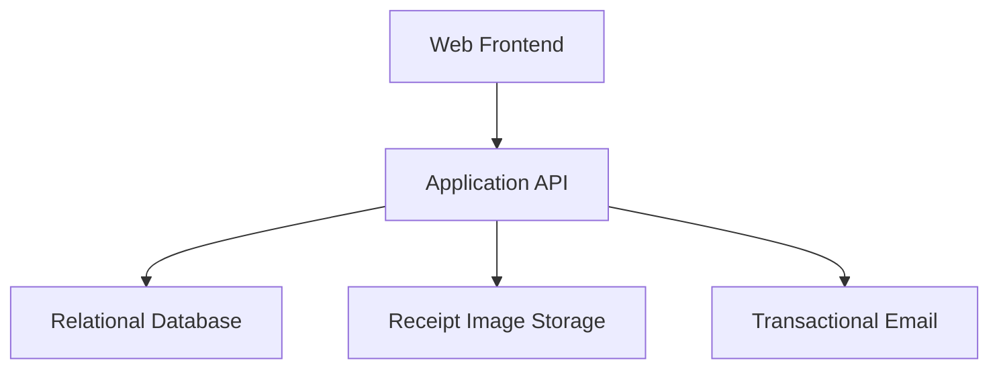
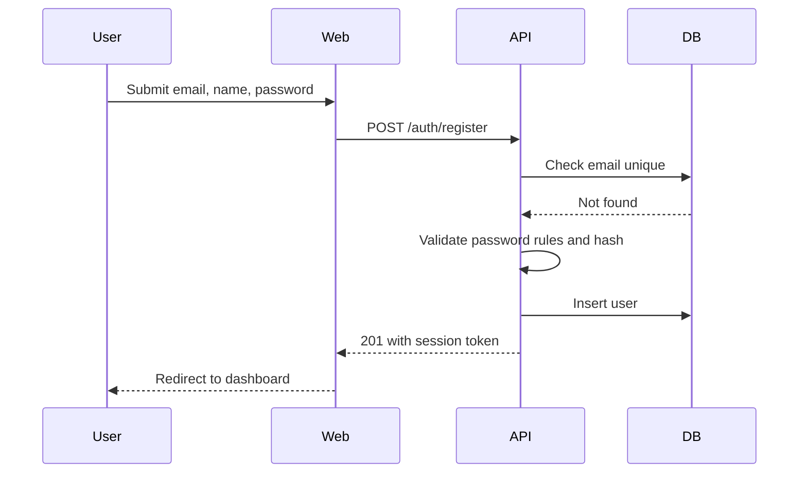
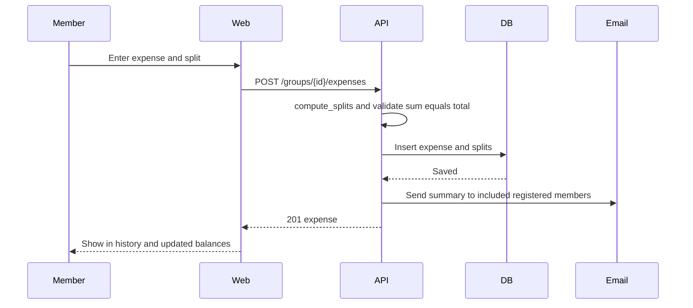
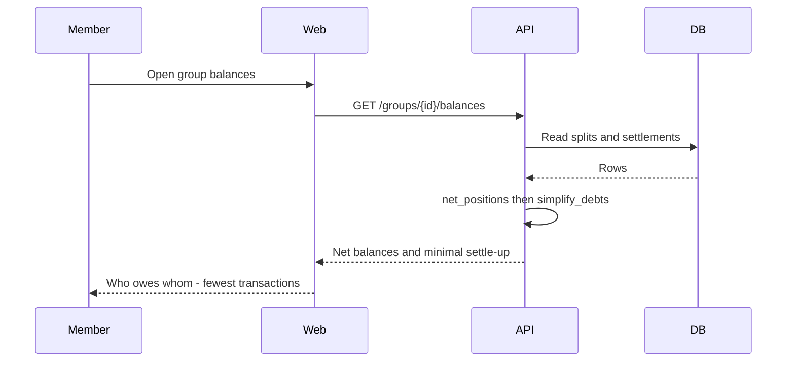
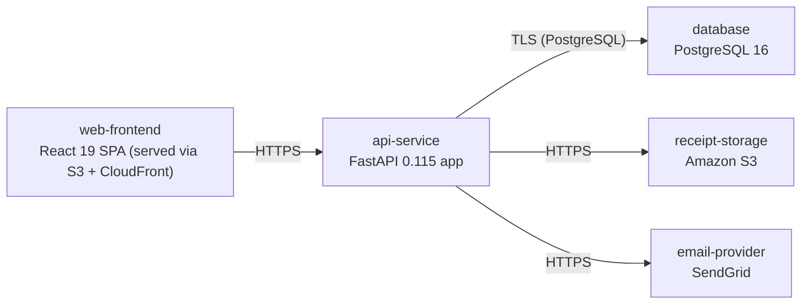

# Architecture

> Maintained by QuorQ AI SDLC. Text between `sdlc:auto` markers is regenerated; anything outside them is yours and is kept.

<!-- sdlc:auto:start narrative -->
## Overview

### ARCH-001 · approved · source: architecture:summary

Split Wise is a free, single-currency, responsive web app for tracking shared group expenses and informal settle-ups, approved as architecture v2.

Architecture decision record, version 2, status approved. System: React 19 SPA frontend talking to a FastAPI 0.115 backend that owns all money logic (flexible splitting: equal/exact/percentage/shares; running per-member and cross-group balances derived from expense and settlement rows; debt simplification minimizing settle-up transactions). PostgreSQL 16 is the relational source of truth for users, groups, members (including name-only placeholders), expenses, splits, settlements and comments. Amazon S3 optionally stores receipt-image references. SendGrid sends three transactional emails: group add, relevant new expense, recorded settlement. Runs in a single AWS region at modest consumer scale; explicitly no billing and no real-money movement.

- ⚠ No requirements-phase input was provided alongside this architecture; cannot independently confirm which US-xxx ids this design satisfies.

### ARCH-002 · approved · source: architecture:components

System is decomposed into five components: web frontend, application API, relational database, receipt storage, and transactional email.

- web: Web Frontend (React 19) — responsive SPA for registration/login, groups, expense logging with split editor, balances, history, settlements and the cross-group dashboard; live-recomputing numbers on phone and desktop.
- api: Application API (FastAPI 0.115) — authenticated REST API holding all business logic: auth/sessions, group and member management, expense and split validation (sums must equal the total), balance computation, debt simplification, settlements, comments, and triggering email notifications.
- db: Relational Database (PostgreSQL 16) — durable, consistent store for users, groups, members, expenses, splits, settlements, comments, invitations and activity; source of truth from which all balances are derived by summation.
- storage: Receipt Image Storage (Amazon S3) — durable object storage for optional receipt-image files; the database keeps only references/URLs.
- email: Transactional Email (SendGrid) — sends the three notification types (added to a group, new relevant expense, recorded settlement) to registered members only; placeholder members are never contacted.

### ARCH-003 · approved · source: architecture:critical_paths

Critical path: visitor registration, login/logout and failed-login handling.

A visitor registers with a unique email, name and a valid password, is signed in and taken to the dashboard. Existing users can log in and out. Failed logins return a single generic message (no distinction between wrong email vs wrong password, per the design).

- ⚠ Architecture input does not cite which US-xxx requirement(s) this path satisfies; cannot link related_ids without fabricating.

### ARCH-004 · approved · source: architecture:critical_paths

Critical path: logging an expense with a flexible split method.

A member records an expense (amount, payer, description, date, category, optional note), chooses included members and a split method (equal, exact, percentage, or shares). The API validates that shares sum exactly to the total, persists the expense and its splits, then emails included registered members about the new expense.

- ⚠ Architecture input does not cite which US-xxx requirement(s) this path satisfies; cannot link related_ids without fabricating.

### ARCH-005 · approved · source: architecture:critical_paths

Critical path: balance computation and debt simplification.

Per-member net balances within a group are derived by summing that group's splits and settlements. The personal dashboard aggregates these net positions across all of a user's groups. Debt simplification computes the fewest payments that leave every member's net position unchanged.

- ⚠ Architecture input does not cite which US-xxx requirement(s) this path satisfies; cannot link related_ids without fabricating.

### ARCH-006 · approved · source: architecture:entities

Relational data model covers users, groups, membership, invitations, expenses, splits, settlements and comments.

- users: id, email, name, password_hash, created_at
- groups: id, name, created_by, created_at
- group_members: id, group_id, user_id, display_name, is_placeholder, joined_at
- group_invitations: id, group_id, email, invited_user_id, status, created_at
- expenses: id, group_id, payer_member_id, amount, description, expense_date, category, note, split_method, receipt_url, created_by, created_at
- expense_splits: id, expense_id, member_id, amount, created_at
- settlements: id, group_id, payer_member_id, recipient_member_id, amount, settled_on, created_by, created_at
- comments: id, expense_id, author_user_id, body, created_at

### ARCH-007 · approved · source: architecture:endpoints

Thirteen REST endpoints cover auth, dashboard, groups/members, expenses/comments, balances and settlements.

- POST /auth/register — create account (unique email, name, valid password), then sign in.
- POST /auth/login — authenticate; generic message on failure.
- POST /auth/logout — end current session.
- GET /me/dashboard — aggregated 'you owe / you are owed' across all user's groups.
- POST /groups — create named persistent group; creator becomes member; rejects empty name.
- GET /groups — list groups the user belongs to.
- GET /groups/{group_id}/members — list members with name and registered/placeholder flag.
- POST /groups/{group_id}/members/invite — invite by email; adds if registered else emails sign-up prompt; sends invitation email.
- POST /groups/{group_id}/members/placeholder — add name-only placeholder member; no email sent.
- POST /groups/{group_id}/expenses — log expense (amount, payer, description, date, category, optional note, included members, split method); validates shares sum to total.
- GET /groups/{group_id}/expenses — group expense/activity history, reverse-chronological, with empty state.
- PATCH /groups/{group_id}/expenses/{expense_id} — edit expense (including note and split); re-validates sums.
- POST /groups/{group_id}/expenses/{expense_id}/comments — post comment, shown with author name and timestamp.
- GET /groups/{group_id}/expenses/{expense_id}/comments — list comments chronologically.
- GET /groups/{group_id}/balances — net per-member balances plus minimised settle-up suggestion.
- POST /groups/{group_id}/settlements — record informal settlement (payer, recipient, amount, date); updates balances; rejects non-positive amount.

### ARCH-008 · approved · source: architecture:deployment_nodes

Single-region AWS deployment: static SPA via S3+CloudFront, API on ECS Fargate, single-AZ RDS Postgres, S3 for receipts, SendGrid as external SaaS.

- web-frontend: React 19 SPA served via S3 + CloudFront (static build).
- api-service: FastAPI 0.115 app, Python 3.12 container on ECS Fargate.
- database: PostgreSQL 16 on Amazon RDS, single-AZ (dev-grade, not multi-AZ/HA).
- receipt-storage: Amazon S3 bucket, single region.
- email-provider: SendGrid, external SaaS API.

- ⚠ Single-AZ RDS is explicitly dev-grade; no separate production HA deployment node is described in this input — unclear if this is final for production or a placeholder.

### ARCH-009 · approved · source: architecture:technology_decisions

Four stack choices: React 19 frontend, FastAPI 0.115 backend, PostgreSQL 16 database, AWS single-region cloud.

- Frontend: React 19 (alternatives considered: Vue, Svelte) — drives the interactive split editor and live-recomputing balances across mobile/desktop browsers, delivering the responsive web app referenced as NFR-001 without a native build.
- Backend: FastAPI 0.115 (alternatives considered: Django REST Framework, Flask) — hosts calculation-heavy logic (split validation, per-member and cross-group balances, debt simplification) behind a typed API consumed by the React screens.
- Database: PostgreSQL 16 (alternatives considered: MySQL, SQLite) — keeps relational, money-exact data consistent so summed balances never double-count; numeric(12,2) holds currency precisely.
- Cloud: AWS (alternatives considered: GCP, Azure) — runs app, RDS PostgreSQL and S3 receipt storage in one single-region account with one bill, matching the single-region modest-scale decision referenced as NFR-006.

- ⚠ This entry references NFR-001 and NFR-006 as the rationale for the React and AWS choices, but neither NFR-001 nor NFR-006 appears in the known requirement key list (US-001..US-022) — flagging this ID mismatch for reconciliation with the requirements phase.
<!-- sdlc:auto:end narrative -->

<!-- sdlc:auto:start building-blocks -->
## Building Block View

| ID | Name | Technology | Responsibility | Depends on |
|---|---|---|---|---|
| web | Web Frontend | React 19 | Responsive SPA for registration/login, groups, expense logging with split editor, balances, history, settlements and the cross-group dashboard. Renders live-recomputing numbers on phone and desktop. | api |
| api | Application API | FastAPI 0.115 | Authenticated REST API holding all business logic: auth/sessions, group and member management, expense and split validation (sums must equal the total), balance computation, debt simplification, settlements, comments, and triggering email notifications. | db, storage, email |
| db | Relational Database | PostgreSQL 16 | Durable, consistent store for users, groups, members, expenses, splits, settlements, comments, invitations and activity. Source of truth from which all balances are derived by summation. | — |
| storage | Receipt Image Storage | Amazon S3 | Durable object storage for optional receipt-image files; the database keeps only references/URLs. | — |
| email | Transactional Email | SendGrid | Sends the three notification types (added to a group, new relevant expense, recorded settlement) to registered members only; placeholder members are never contacted. | — |

<!-- sdlc:auto:end building-blocks -->

<!-- sdlc:auto:start runtime -->
## Runtime View

### Register and authenticate

A visitor registers with unique email, name and a valid password, is signed in and taken to the dashboard; existing users log in and out. Failed logins return a single generic message.

- **Components:** web, api, db
- **Modules:** auth.router, auth.service, auth.security, users.repository
- **Key functions:** register(email, name, password), hash_password(password), verify_password(password, hash), login(email, password), issue_token(user_id), logout(token)

### Log expense with split

A member records an expense (amount, payer, description, date, category, optional note) and chooses included members and a split method. The API validates that shares sum exactly to the total, persists expense and splits, then emails included registered members.

- **Components:** web, api, db, email
- **Modules:** expenses.router, expenses.service, splits.calculator, notifications.service
- **Key functions:** create_expense(group_id, payload), compute_splits(method, amount, members, inputs), validate_split_sum(shares, amount), notify_expense_members(expense)

### Compute balances and simplify debts

Per-member net balances within a group are derived by summing splits and settlements; the dashboard aggregates across all the user's groups; debt simplification returns the fewest payments that leave every net position unchanged.

- **Components:** web, api, db
- **Modules:** balances.service, balances.aggregator, debt.simplifier
- **Key functions:** group_balances(group_id), net_positions(group_id), simplify_debts(net_positions), overall_balances(user_id)

<!-- sdlc:auto:end runtime -->

<!-- sdlc:auto:start deployment-view -->
## Deployment View

| Name | Service | Runtime | Scaling | Environment |
|---|---|---|---|---|
| web-frontend | React 19 SPA (served via S3 + CloudFront) | Static build | CDN edge cache | dev |
| api-service | FastAPI 0.115 app | Python 3.12 container on ECS Fargate | 1-2 tasks, manual at dev scale | dev |
| database | PostgreSQL 16 | Amazon RDS for PostgreSQL 16, single-AZ dev | Single instance | dev |
| receipt-storage | Amazon S3 | S3 bucket (single region) | Managed | dev |
| email-provider | SendGrid | External SaaS API | Managed | dev |

| Source | Target | Protocol |
|---|---|---|
| web-frontend | api-service | HTTPS |
| api-service | database | TLS (PostgreSQL) |
| api-service | receipt-storage | HTTPS |
| api-service | email-provider | HTTPS |

<!-- sdlc:auto:end deployment-view -->

<!-- sdlc:auto:start decisions -->
## Architecture Decisions

| Layer | Choice | ADR |
|---|---|---|
| Frontend | React 19 | [ADR-0001](adr/frontend.md) |
| Backend | FastAPI 0.115 | [ADR-0002](adr/backend.md) |
| Database | PostgreSQL 16 | [ADR-0003](adr/database.md) |
| Cloud | AWS | [ADR-0004](adr/cloud.md) |
<!-- sdlc:auto:end decisions -->

<!-- sdlc:auto:start links -->
## Related Documents

- [Data Model](data-model.md)
- [API Specification](api/openapi.yaml)
- [Architecture Decision Records](adr/README.md)
<!-- sdlc:auto:end links -->
