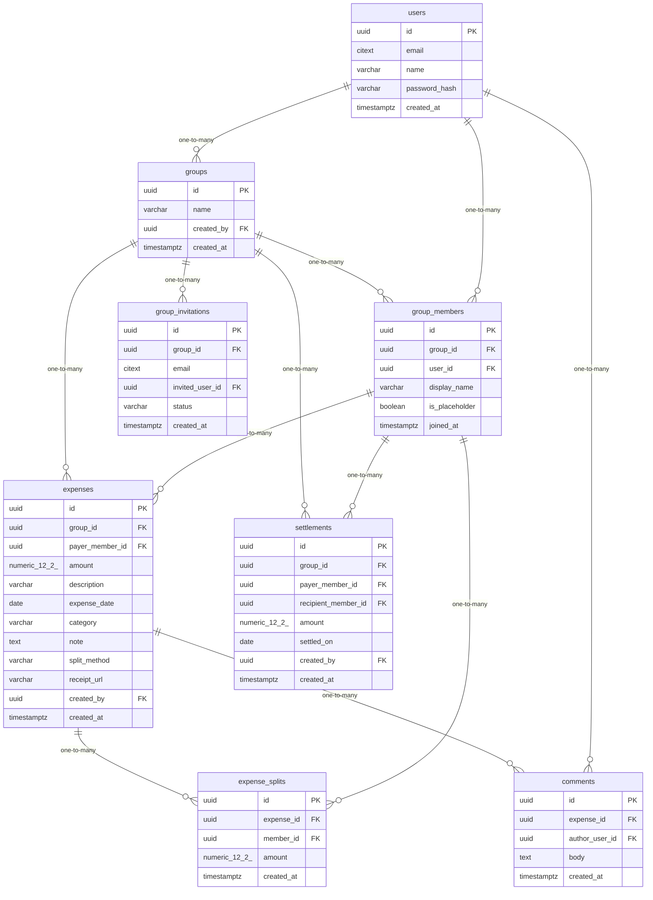

# Data Model

<!-- sdlc:auto:start entities -->
### users

| Field | Type | PK | FK | Nullable |
|---|---|---|---|---|
| id | uuid | True | — | False |
| email | citext | False | — | False |
| name | varchar | False | — | False |
| password_hash | varchar | False | — | False |
| created_at | timestamptz | False | — | False |

### groups

| Field | Type | PK | FK | Nullable |
|---|---|---|---|---|
| id | uuid | True | — | False |
| name | varchar | False | — | False |
| created_by | uuid | False | users.id | False |
| created_at | timestamptz | False | — | False |

### group_members

| Field | Type | PK | FK | Nullable |
|---|---|---|---|---|
| id | uuid | True | — | False |
| group_id | uuid | False | groups.id | False |
| user_id | uuid | False | users.id | True |
| display_name | varchar | False | — | False |
| is_placeholder | boolean | False | — | False |
| joined_at | timestamptz | False | — | False |

### group_invitations

| Field | Type | PK | FK | Nullable |
|---|---|---|---|---|
| id | uuid | True | — | False |
| group_id | uuid | False | groups.id | False |
| email | citext | False | — | False |
| invited_user_id | uuid | False | users.id | True |
| status | varchar | False | — | False |
| created_at | timestamptz | False | — | False |

### expenses

| Field | Type | PK | FK | Nullable |
|---|---|---|---|---|
| id | uuid | True | — | False |
| group_id | uuid | False | groups.id | False |
| payer_member_id | uuid | False | group_members.id | False |
| amount | numeric(12,2) | False | — | False |
| description | varchar | False | — | False |
| expense_date | date | False | — | False |
| category | varchar | False | — | False |
| note | text | False | — | True |
| split_method | varchar | False | — | False |
| receipt_url | varchar | False | — | True |
| created_by | uuid | False | users.id | False |
| created_at | timestamptz | False | — | False |

### expense_splits

| Field | Type | PK | FK | Nullable |
|---|---|---|---|---|
| id | uuid | True | — | False |
| expense_id | uuid | False | expenses.id | False |
| member_id | uuid | False | group_members.id | False |
| amount | numeric(12,2) | False | — | False |
| created_at | timestamptz | False | — | False |

### settlements

| Field | Type | PK | FK | Nullable |
|---|---|---|---|---|
| id | uuid | True | — | False |
| group_id | uuid | False | groups.id | False |
| payer_member_id | uuid | False | group_members.id | False |
| recipient_member_id | uuid | False | group_members.id | False |
| amount | numeric(12,2) | False | — | False |
| settled_on | date | False | — | False |
| created_by | uuid | False | users.id | False |
| created_at | timestamptz | False | — | False |

### comments

| Field | Type | PK | FK | Nullable |
|---|---|---|---|---|
| id | uuid | True | — | False |
| expense_id | uuid | False | expenses.id | False |
| author_user_id | uuid | False | users.id | False |
| body | text | False | — | False |
| created_at | timestamptz | False | — | False |
<!-- sdlc:auto:end entities -->

<!-- sdlc:auto:start relationships -->
| Source | Target | Type |
|---|---|---|
| users | groups | one-to-many |
| groups | group_members | one-to-many |
| users | group_members | one-to-many |
| groups | group_invitations | one-to-many |
| groups | expenses | one-to-many |
| group_members | expenses | one-to-many |
| expenses | expense_splits | one-to-many |
| group_members | expense_splits | one-to-many |
| groups | settlements | one-to-many |
| group_members | settlements | one-to-many |
| expenses | comments | one-to-many |
| users | comments | one-to-many |
<!-- sdlc:auto:end relationships -->

<!-- sdlc:auto:start er-diagram -->

<!-- sdlc:auto:end er-diagram -->
