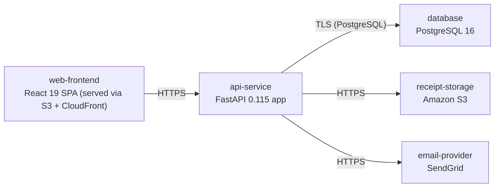

# Deployment Guide

> Maintained by QuorQ AI SDLC. Text between `sdlc:auto` markers is regenerated; anything outside them is yours and is kept.

<!-- sdlc:auto:start how-it-deploys -->
Pushes to `main` run `.github/workflows/deploy.yml`, which builds the API image (if there is a backend) and deploys the SPA to AWS Amplify. Commits touching only `docs/sdlc/**` don't deploy. Deployments can also be started from the platform's Deployment tab.
<!-- sdlc:auto:end how-it-deploys -->

<!-- sdlc:auto:start environments -->
| Name | Service | Runtime | Scaling | Environment |
|---|---|---|---|---|
| web-frontend | React 19 SPA (served via S3 + CloudFront) | Static build | CDN edge cache | dev |
| api-service | FastAPI 0.115 app | Python 3.12 container on ECS Fargate | 1-2 tasks, manual at dev scale | dev |
| database | PostgreSQL 16 | Amazon RDS for PostgreSQL 16, single-AZ dev | Single instance | dev |
| receipt-storage | Amazon S3 | S3 bucket (single region) | Managed | dev |
| email-provider | SendGrid | External SaaS API | Managed | dev |
<!-- sdlc:auto:end environments -->

<!-- sdlc:auto:start live -->
_Not deployed yet._
<!-- sdlc:auto:end live -->

<!-- sdlc:auto:start topology -->

<!-- sdlc:auto:end topology -->
